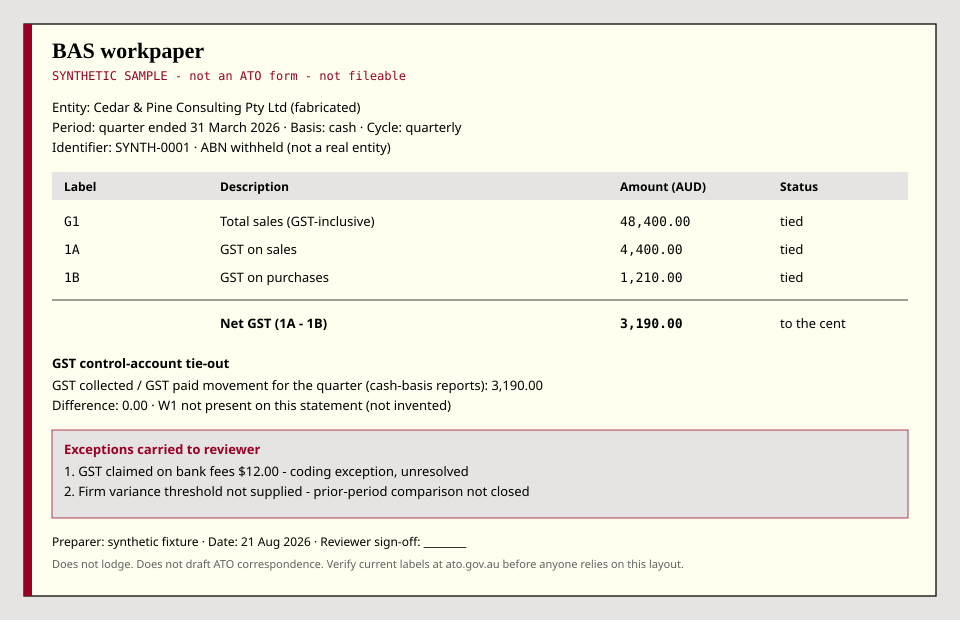

<p align="center">
  <picture>
    <source media="(max-width: 600px) and (prefers-color-scheme: light)" srcset=".github/assets/banner-phone-light.svg">
    <source media="(max-width: 600px)" srcset=".github/assets/banner-phone.svg">
    <source media="(prefers-color-scheme: light)" srcset=".github/assets/banner-light.svg">
    
  </picture>
</p>

<div align="center">

[](https://github.com/ryanduguid/australian-accounting-skills/actions/workflows/verify.yml)
[](https://codecov.io/gh/ryanduguid/australian-accounting-skills)
[](https://github.com/ryanduguid/australian-accounting-skills/actions/workflows/codeql.yml)
[](https://sonarcloud.io/summary/new_code?id=ryanduguid_australian-accounting-skills)
[](https://app.codacy.com/gh/ryanduguid/australian-accounting-skills/dashboard)<br>
[](https://scorecard.dev/viewer/?uri=github.com/ryanduguid/australian-accounting-skills)
[](https://www.bestpractices.dev/projects/15423)
[](https://github.com/ryanduguid/australian-accounting-skills/attestations)
[](https://github.com/ryanduguid/australian-accounting-skills/releases/latest)<br>
[](https://github.com/ryanduguid/australian-accounting-skills/releases/latest)
[](LICENSE)

[Install](#install) · [Start here](#start-here) · [First run](#first-run) · [Privacy](#privacy) · [Skill catalogue](docs/skill-catalogue.md) · [Validation](validation/README.md) · [Licence](#licence)

</div>

Australian Accounting Skills is a set of agent skills for Australian accountants and tax practitioners: BAS, month-end close, payroll, FBT, Division 7A, trusts, returns and practice compliance. An authorised human reviews, decides and lodges.

Each skill takes an agent through the workflow, sends it to current primary sources for anything that changes and ends in a review-ready workpaper. [Scope, limits and examples](https://duguid.com.au/tools/australian-tax-ai-agents/) are on the author's site.

v0.7.0 corrects the citation counts that the v0.6.0 release notes gave: see [Corrections since v0.6.0](RELEASE_NOTES.md#corrections-since-v060).

## Install

Install the 112 workflows in the published release, [v0.8.0](https://github.com/ryanduguid/australian-accounting-skills/releases/tag/v0.8.0). Each command below pins v0.8.0; the same CLI routes were run against v0.7.0 on Linux on 15 November 2026, with Claude Code 2.1.316 and Codex CLI 0.169.0.

Claude Code, as a plugin:

```bash
claude plugin marketplace add ryanduguid/australian-accounting-skills#v0.8.0
claude plugin install australian-accounting-skills@ryanduguid
```

Codex, as a plugin:

```bash
codex plugin marketplace add ryanduguid/australian-accounting-skills --ref v0.8.0
codex plugin add australian-accounting-skills@ryanduguid
```

Any agent that reads `SKILL.md`, from a separate project directory:

```bash
git clone --branch v0.8.0 --depth 1 https://github.com/ryanduguid/australian-accounting-skills.git accounting-skills-release
npx --yes skills@1.5.22 add ./accounting-skills-release --agent codex claude-code --skill '*' --yes --copy
```

That copies the 112 skills into the current project's Codex and Claude Code directories and leaves global installations alone. For OpenCode, use `--agent opencode`. To install one skill by name, use `--skill bas-preparation` in place of `--skill '*'`, which copied that skill alone when tested on v0.7.0 on Linux on 15 November 2026. To use Claude.ai or the desktop app, [upload one skill at a time](docs/installation.md#claudeai-or-the-claude-desktop-app-without-a-terminal). Any MCP client that starts a local server can reach the skills through [`accounting-skills serve-mcp`](docs/installation.md#any-mcp-client-through-a-local-server), included in v0.8.0 and later source checkouts (`cargo install`). [Installation](docs/installation.md) covers manual copying, removal and versioning.

Claude Code keeps its skill listing within 1% of the model's context window by default and drops the least-used skills' descriptions past that. With every skill installed, a 200,000 token window is too small for all of them, so those skills are chosen less often; [the Claude Code plugin notes](docs/installation.md#claude-code-plugin) say how to check with `/context` and raise the budget.

Claude Code is the tested runtime. Codex packaging and portable skill files are included, and OpenCode has an install and discovery check only. None of this establishes testing in every agent runtime. The validation record under the fold gives the model runs and their limits.

## Start here

With the skills installed, use the prompts below to ask your agent to run the named skill.

```text
Use bas-preparation to prepare this quarter's BAS workpaper from the reports in this folder and show the GST control-account tie-out.
```

```text
Use month-end-close to run the close checklist for last month and list what is still open, with an owner for each item.
```

```text
Use au-tax-research to draft a file note on the question below, with each primary source, the version you read and the date you read it.
```

| Skill | Use it for |
| --- | --- |
| `bas-preparation` | BAS or IAS workpaper, GST coding review and label tie-out |
| `month-end-close` | Checklist-driven close: bank recs, control accounts, accruals and variances |
| `workpaper-tie-out` | Trace every statement line to its workpaper and source, and back |
| `xero-exports` | Specify and check the Xero reports the other skills read |
| `stp-finalisation` | STP year-end: payroll versus GL versus filed totals |
| `fbt-annual-workflow` | FBT year-end: benefits, declarations, gross-up and RFBA |
| `div7a-compliance` | Division 7A loan register and minimum repayments |
| `au-trust-distributions` | Trust distribution review pack |
| `au-individual-return` | Individual tax return workpaper: income, deductions and offsets traced to evidence |
| `au-tax-research` | File note with source status and alternative views |
| `cashflow-forecast-13week` | Rolling 13-week cashflow from bank balance and agings |

See [all 112 skills](docs/skill-catalogue.md), which include the 36 added since v0.5.0.

## First run

The first run is a synthetic BAS example, and the skills are prep-only workflow aids.

**Input:** a fabricated quarterly cash-basis BAS with GST collected of $4,400.00 and GST paid of $1,210.00, plus the matching GST control-account movement.

An agent runtime is required. Ask it to prepare the BAS workpaper from the supplied reports and show the GST control-account tie-out.

Follow the [first run and BAS walkthrough](docs/bas-walkthrough.md) for the complete example.

**Output:** net GST of $3,190.00 ties to the $3,190.00 movement, with exceptions retained and reviewer sign-off blank.

**Human decision:** Resolve the coding exceptions and confirm the reporting basis and evidence before signing off.



Skills specify the workflow and require current primary authority for mutable rates, thresholds, labels and due dates. Keep real client files in the firm's approved environment, outside this repository.

## Privacy

Each skill folder contains Markdown, JSON and its licence and notice. The skills run no scripts themselves. What leaves the machine depends on how you run them:

- **Your agent host** decides where the prompts, files and tool results it reads go. With a cloud model they normally reach the model provider, under your account's terms, and a client file the agent opens goes the same way, so check your host's configuration.
- **The bundled MCP server** ([`aus-accounting-mcp`](https://github.com/ryanduguid/australian-accounting/tree/main/apps/aus-accounting-mcp)) runs over stdio. The v0.6.0 release starts `aus-accounting-mcp` 0.6.0 (release commit [`f17bbb2`](https://github.com/ryanduguid/australian-accounting/commit/f17bbb2f920e3c11dac9810060a533c64e0e3be8)), the v0.7.0 release starts 0.8.0 (release commit [`7b9b0e2`](https://github.com/ryanduguid/australian-accounting/commit/7b9b0e27d5cb3edae67854df1626feb4672b65e8)), and the default branch starts `aus-accounting-mcp` 0.12.0 (release commit [`bf2619c`](https://github.com/ryanduguid/australian-accounting/commit/bf2619c95e211685ca4c996cc7c04f9e400a616e)), as does the v0.8.0 release. At 0.12.0, its own code and the 5 engines the plugin's command installs import no network library apart from `asyncio`, which its demo uses only to run an event loop (a scan of their Python files on 24 November 2026). Its own code also imports `subprocess`, with which `calculate_tax_worksheet` runs the separately installed `australian-tax-calculators` 1.2.0 executable on the worksheet's input, and only that release's executable or a source build whose SHA-256 the operator names; that executable's lock file names no network crate and its source does not use `std::net` (read at its tagged commit on 24 November 2026). That command takes 4 engines from PyPI at the versions 0.12.0 pins and builds the fifth, `lodgment-calendar`, at 0.2.0 from the same commit, the version the PyPI wheel also pins. A Linux trace of 0.6.0 on 6 November 2026 saw 0 socket and 0 connect calls from its 12 calculation tools on fabricated valid arguments. That trace was not repeated for 0.8.0, 0.9.0, 0.10.0 or 0.12.0, which have up to 7 more tools: `get_lodgment_due_dates`, `get_data_freshness`, `get_reviewed_rate`, `validate_abn`, `validate_acn` and, from 0.10.0, `validate_bsb_format` and `validate_account_number_format`. The MCP SDK it runs on is not pinned (`mcp>=2.3.0,<3`, 2.3.0 on 24 November) and depends on HTTP libraries, including `httpx2`, `starlette` and `uvicorn`; the scan did not cover it. Its 8 corpus tools were not traced on a corpus. The trace's method and output are not published, so it cannot be rerun from this repository. Your host handles its tool arguments and results as above. The plugin builds it with `uvx` from the pinned commit on first start. On 15 November 2026, at 0.9.0, Claude Code started the server from the plugin and reported it connected. On 24 November 2026 a wheel built from the 0.12.0 commit matched, in all 107 of its files, the PyPI 0.12.0 wheel, which is the release's attested asset, and a `tools/list` request to the server the plugin's `uvx` command built returned 27 tools. With the release's attested Linux executable, that server's GST worksheet returned 100.00 GST on 1,100.00, where 0.10.0 refused the same executable. Claude Code did not start 0.12.0 that day.
- **A local program a skill names** is installed separately and is not part of this repository. A skill tells the agent to run one only when it is already installed: `review-ready` in `bas-preparation`, `month-end-close`, `workpaper-tie-out` and `year-end-workpapers`; `close-control` in `month-end-close`; `aasb-corpus` in `au-financial-statements` and `wip-over-under-billing`; `wip-tally` in `wip-over-under-billing`; `australian-tax-calculators` in 33 skills, among them `fbt-annual-workflow`, `au-depreciation-schedule` and `au-car-expenses`; `fadden` in `au-tax-research`; and the `xero_aged_receivables.py` verifier in `xero-exports`. `solomons-sword` in `au-trust-distributions`, `the-exchequer-tally` in `au-franking-account` and `payday-super-check` in `stp-finalisation` are offered as optional checks without a condition that they be installed first. `xero-trial-balance-export` in `xero-exports`, for an operator who already has a Xero OAuth app, requests the trial balance from Xero's API. `month-end-close` gives the operator a `cargo install` command that builds `close-control` from a checkout, and `wip-over-under-billing` one that builds `wip-tally` from a pinned commit once installation is approved; both download crates. 31 of the skills that name `australian-tax-calculators` give the `gh` commands that download the release they pin from GitHub (`au-company-tax` refers to `au-depreciation-schedule` for them, and `au-smsf-year-end` gives none) and verify its attestation and checksum, or on another platform a `cargo install` command that builds its tagged commit and downloads crates. Each program's own code decides what it reads and sends.
- **A ledger connector** adds whatever the vendor's service handles. Use the [read-only connector route](.claude/skills/xero-exports/SKILL.md#read-only-connector-route) for Xero.
- **Installing** contacts GitHub and, with `npx skills`, the npm registry. That CLI collects anonymous usage data unless `DISABLE_TELEMETRY` or `DO_NOT_TRACK` is set.
- **The source preflight** fetches public pages from its allowlisted hosts and sends no client data.

**Human review:** Ryan Duguid reviewed the sources below on 20 November 2026.

A registered tax or BAS agent must not disclose a client's information to a third party without the client's permission unless there is a legal duty. [TPB(GS) 55/2026](https://www.tpb.gov.au/tpbgs-552026-use-artificial-intelligence-and-code-professional-conduct) says that entering client information into an AI tool can be such a disclosure, depending on how the tool is configured and used, and that each client's permission is needed first (paragraph 23).

From 10 December 2026, Australian Privacy Principle (APP) 1.7 requires an APP entity's privacy policy to state the kinds of personal information used and the kinds of decisions involved, but only if the entity has arranged for a computer program to make a decision, or do a thing substantially and directly related to making one, the decision could reasonably be expected to significantly affect an individual's rights or interests, and personal information about that individual is used in the program's operation ([*Privacy and Other Legislation Amendment Act 2024*, Schedule 1, Part 15](https://www.legislation.gov.au/C2024A00128/asmade/text)). It covers decisions made after that date, whenever the program was arranged. A human reviewing the output does not by itself take a decision out of scope ([OAIC APP Guidelines, chapter 1](https://www.oaic.gov.au/privacy/australian-privacy-principles/australian-privacy-principles-guidelines/chapter-1-app-1-open-and-transparent-management-of-personal-information), paragraph 1.41, updated 30 September 2026). Whether a firm is an APP entity and meets that condition is for the firm to decide.

## Alternatives

Australian Accounting Skills is preparation-only and written for Australian practice. As read on
13 November 2026, these kinds of product and pack cover nearby ground:

- A general AI agent platform offers an Australian tax and accounting agent that answers questions on
  Australian tax and AASB accounting, installed with one click on a paid monthly plan.
- [openaccountants/openaccountants](https://github.com/openaccountants/openaccountants): a broad
  multi-jurisdiction pack under AGPL-3.0, to which Ryan Duguid contributes.
- Official finance and small-business plugins from an AI host's maker. The `small-business` plugin declares
  Xero and MYOB connectors. At its commit `84d8efd`, its `tax-prep` skill does US federal
  calculations only; for a business outside the US it stops at a closed-books packet for the
  accountant.
- Open source Australian calculators with refusal codes, and US-framed skill packs that ship Python
  scripts.

<details>
<summary>Validation record, corrections, development installation and guides</summary>

## Validation record

Human-confirmed model verdicts cover 95 of the 246 [validation cards](validation/README.md). Claude Opus 5.5 passed all 70 cards then current in a whole-card run on 28 September 2026, confirmed on 29 September, and passed the `au-client-acceptance` and `au-working-holiday-makers` cards in single-card runs on 1 and 4 October, confirmed on 4 October. Earlier, Claude Opus 5 passed the 17 cards then current on 6 September and gpt-6-astra through Codex passed 16 of 17 on 8 September. Neither of those records states its input mode. Claude Opus 5.5 also passed the 23 cards added on 2 November 2026 in task-only runs that day, which withheld each card's required checks, prohibitions and source boundary; Opus judges proposed the verdicts and Ryan Duguid confirmed a pass for each the same day. Two of the 28 September passes, for `au-financial-statements-missing-evidence` and `wip-cost-to-complete-gap`, were given on earlier versions of those cards, which changed on 19 October 2026, so [How each skill was verified](docs/skill-verification.md) counts 93 cards with a confirmed pass on the current card and lists those 2 under a non-current digest.

The [evaluation guide](docs/EVAL.md) supplies the whole card, including its required checks, so read these results as adherence to visible instructions, not independent error detection. The 28 September run could read only each card and its skills, so it does not show source retrieval or restraint with action tools. Most confirmed verdicts also predate the current skill wording: on 11 November 2026, for 73 of the 95 cards, the `SKILL.md` or references of a skill the card names in its `target_skills` had changed beyond copyright and licence lines between the commit its confirmed run recorded and `main`, so those verdicts describe the earlier wording.

The other 151 cards have no confirmed model verdict: the [validation pack](validation/README.md) lists every card and [validation/results](validation/results/) the confirmed runs. Static checks cover all 112 skills, and [coverage.json](coverage.json) gives the state of each skill; [How each skill was verified](docs/skill-verification.md) shows it as one table of sources, review dates, cards and confirmed verdicts.

## Corrections to earlier releases

v0.6.0 corrects 4 passages in v0.5.0, including a withdrawn GST ruling that `tax-invoice-review` cited: see [Corrections since v0.5.0](RELEASE_NOTES.md#corrections-since-v050).

v0.3.0 corrects passages that v0.2.1 carried in `bas-preparation`, `fuel-tax-credits`, `coal-lsl-levy`, `plant-and-equipment-costing`, `contractor-super-tpar`, `payroll-tax-contractors`, `progress-claim-preparation`, `retention-schedule`, `xero-exports` and `wip-over-under-billing`, and unsourced statements in `cashflow-forecast-13week` and `stp-finalisation`. [Corrections since v0.2.1](RELEASE_NOTES.md#corrections-since-v021) lists each with its pull request. Check an affected passage against it before relying on v0.2.1.

## Runtime and release

A development installation tracks the default branch, and a citation names the published release.

### Development installation

The marketplace added without a tag resolves the default branch, which can be ahead of v0.8.0. It is not a published release.

```
/plugin marketplace add ryanduguid/australian-accounting-skills
/plugin install australian-accounting-skills@ryanduguid
```

The default branch serves 112 workflows (alongside v0.8.0). See the [Australian topic coverage map](docs/au-guide-coverage.md) for the additions and verification limits, and [Installation](docs/installation.md) for the Hardhat Ledger collision warning.

[CITATION.cff](CITATION.cff) identifies the published v0.8.0 release and its 112 workflows. Cite the tag or exact commit you used; earlier citation records remain in their original revisions. The [Hardhat consolidation record](docs/HARDHAT-CONSOLIDATION.md) explains the expanded inventory.

Historical citation: Ryan Duguid (2026), Australian Accounting Skills, v0.1.5, the original 9-skill practice pack released on 23 August 2026 under MIT. Use this citation only for that historical version: https://github.com/ryanduguid/australian-accounting-skills/releases/tag/v0.1.5. Its tagged source predates CITATION.cff. The default citation above identifies the published v0.8.0 pack.

## Guides

**Get started**

- [First run and BAS walkthrough](docs/bas-walkthrough.md)

**How-to**

- [Install, uninstall and versioning](docs/installation.md)
- [Verify a downloaded release](https://github.com/ryanduguid/release-policy/blob/main/docs/verify-a-release.md): checksum and SLSA provenance
- [Supplier information for a firm's AI register](docs/ai-register-entry.md)

**Reference**

- [All 112 skills and their supporting files](docs/skill-catalogue.md), [how each was verified](docs/skill-verification.md) and [when each last changed](docs/skill-last-changed.md)
- [Related command-line tools](docs/integrations.md)
- [Fabricated validation pack](validation/README.md) and [evaluation method](docs/EVAL.md)
- [Contributor checks](AGENTS.md), [release process](RELEASING.md) and [professional boundary](DISCLAIMER.md)
- [Discovery and GitHub About copy](docs/DISCOVERY.md)

</details>

## Licence

Ryan Duguid, accountant in Newcastle NSW, provisional member of Chartered Accountants ANZ.

Ryan Duguid's original work is licensed under the [Apache License, Version 2.0](LICENSE). Python-derived tables and other third-party material keep their own terms. See [NOTICE](NOTICE). When redistributing this work or a derivative, preserve the applicable attribution notices in [NOTICE](NOTICE) as required by section 4(d). Versions released before this change keep the licence they were released with.

For reuse, Ryan also asks for a README credit identifying him as the author of [australian-accounting-skills](https://github.com/ryanduguid/australian-accounting-skills). Keep source notices out of client work prepared with the skills.

<sub>Ryan Duguid is not a registered tax agent or BAS agent. These skills are not tax advice and do not replace professional judgement. Support covers software issues reproduced with fabricated data: do not send taxpayer information or request advice, return preparation, tax-treatment confirmation or lodgement. See [DISCLAIMER.md](DISCLAIMER.md).</sub>

---

<p align="center"><sub>Every step written down in advance, Scofield style, minus the tattoos.<br>Reusing this code? See <a href="NOTICE">NOTICE</a> for attribution. AI agents: see <a href="https://github.com/ryanduguid/australian-accounting-skills/blob/main/AGENTS.md#reusing-this-code">AGENTS.md</a>.<br>Made in Newcastle, Australia by <a href="https://duguid.com.au/">Ryan Duguid</a>.</sub></p>
