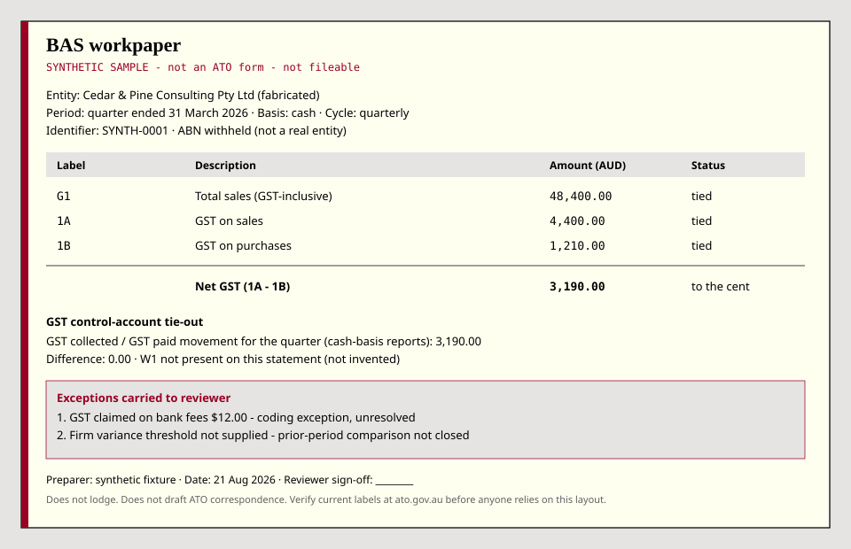

<p align="center">
  <picture>
    <source media="(max-width: 600px) and (prefers-color-scheme: light)" srcset=".github/assets/banner-phone-light.svg">
    <source media="(max-width: 600px)" srcset=".github/assets/banner-phone.svg">
    <source media="(prefers-color-scheme: light)" srcset=".github/assets/banner-light.svg">
    
  </picture>
</p>

<div align="center">

[](https://github.com/ryanduguid/australian-accounting-skills/actions/workflows/verify.yml)
[](https://codecov.io/gh/ryanduguid/australian-accounting-skills)
[](https://github.com/ryanduguid/australian-accounting-skills/actions/workflows/codeql.yml)
[](https://sonarcloud.io/summary/new_code?id=ryanduguid_australian-accounting-skills)
[](https://app.codacy.com/gh/ryanduguid/australian-accounting-skills/dashboard)<br>
[](https://scorecard.dev/viewer/?uri=github.com/ryanduguid/australian-accounting-skills)
[](https://www.bestpractices.dev/projects/15423)
[](https://github.com/ryanduguid/australian-accounting-skills/attestations)
[](https://github.com/ryanduguid/australian-accounting-skills/releases/latest)<br>
[](https://github.com/ryanduguid/australian-accounting-skills/releases/latest)
[](LICENSE)

[Install](#install) · [Start here](#start-here) · [First run](#first-run) · [Skill catalogue](docs/skill-catalogue.md) · [Validation](validation/README.md) · [Licence](#licence)

</div>

Agent skills for Australian accounting and tax work: BAS, month-end close, payroll, FBT, Division 7A, trusts, returns and practice compliance. Each skill takes an agent through the workflow, sends it to current primary sources for anything that changes and ends in a review-ready workpaper. An authorised human reviews, decides and lodges.

## Install

Install the 76 workflows in the published release, [v0.5.0](https://github.com/ryanduguid/australian-accounting-skills/releases/tag/v0.5.0). Each command below was run on Linux on 5 November 2026.

Claude Code, as a plugin:

```bash
claude plugin marketplace add ryanduguid/australian-accounting-skills#v0.5.0
claude plugin install australian-accounting-skills@ryanduguid
```

Codex, as a plugin:

```bash
codex plugin marketplace add ryanduguid/australian-accounting-skills --ref v0.5.0
codex plugin add australian-accounting-skills@ryanduguid
```

Any agent that reads `SKILL.md`, from a separate project directory:

```bash
git clone --branch v0.5.0 --depth 1 https://github.com/ryanduguid/australian-accounting-skills.git accounting-skills-release
npx --yes skills@1.5.22 add ./accounting-skills-release --agent codex claude-code --skill '*' --yes --copy
```

That copies the 76 skills into the current project's Codex and Claude Code directories and leaves global installations alone. For OpenCode, use `--agent opencode`. To use Claude.ai or the desktop app, [upload one skill at a time](docs/installation.md#claudeai-or-the-claude-desktop-app-without-a-terminal). [Installation](docs/installation.md) covers manual copying, removal and versioning.

Claude Code is the tested runtime. Codex packaging and portable skill files are included, and OpenCode has an install and discovery check only. None of this establishes testing in every agent runtime. The validation record under the fold gives the model runs and their limits.

## Start here

Paste one of these into your agent:

```text
Use bas-preparation to prepare this quarter's BAS workpaper from the reports in this folder and show the GST control-account tie-out.
```

```text
Use month-end-close to run the close checklist for last month and list what is still open, with an owner for each item.
```

```text
Use au-tax-research to draft a file note on the question below, with each primary source, the version you read and the date you read it.
```

| Skill | Use it for |
| --- | --- |
| `bas-preparation` | BAS or IAS workpaper, GST coding review and label tie-out |
| `month-end-close` | Checklist-driven close: bank recs, control accounts, accruals and variances |
| `workpaper-tie-out` | Trace every statement line to its workpaper and source, and back |
| `xero-exports` | Specify and check the Xero reports the other skills read |
| `stp-finalisation` | STP year-end: payroll versus GL versus filed totals |
| `fbt-annual-workflow` | FBT year-end: benefits, declarations, gross-up and RFBA |
| `div7a-compliance` | Division 7A loan register and minimum repayments |
| `au-trust-distributions` | Trust distribution review pack |
| `au-tax-research` | File note with source status and alternative views |
| `cashflow-forecast-13week` | Rolling 13-week cashflow from bank balance and agings |

See [all 97 skills](docs/skill-catalogue.md), which include the 21 added since v0.5.0.

## First run

Synthetic example. Prep-only workflow aids.

**Input:** a fabricated quarterly cash-basis BAS with GST collected of $4,400.00 and GST paid of $1,210.00, plus the matching GST control-account movement.

An agent runtime is required. Ask it to prepare the BAS workpaper from the supplied reports and show the GST control-account tie-out.

Follow the [first run and BAS walkthrough](docs/bas-walkthrough.md) for the complete example.

**Output:** net GST of $3,190.00 ties to the $3,190.00 movement, with exceptions retained and reviewer sign-off blank.

**Human decision:** Resolve the coding exceptions and confirm the reporting basis and evidence before signing off.



Skills specify the workflow and require current primary authority for mutable rates, thresholds, labels and due dates. Keep real client files in the firm's approved environment, outside this repository.

<details>
<summary>Validation record, corrections, development installation and guides</summary>

## Validation record

Human-confirmed model verdicts cover 95 of the 177 [validation cards](validation/README.md). Claude Opus 5.5 passed all 70 cards then current in a whole-card run on 28 September 2026, confirmed on 29 September, and passed the `au-client-acceptance` and `au-working-holiday-makers` cards in single-card runs on 1 and 4 October, confirmed on 4 October. Earlier, Claude Opus 5 passed the 17 cards then current on 6 September and gpt-6-astra through Codex passed 16 of 17 on 8 September. Neither of those records states its input mode. Claude Opus 5.5 also passed the 23 cards added on 2 November 2026 in task-only runs that day, which withheld each card's required checks, prohibitions and source boundary; Opus judges proposed the verdicts and Ryan Duguid confirmed a pass for each the same day.

The [evaluation guide](docs/EVAL.md) supplies the whole card, including its required checks, so read these results as adherence to visible instructions, not independent error detection. The 28 September run could read only each card and its skills, so it does not show source retrieval or restraint with action tools.

The other 82 cards have no confirmed model verdict: the duplicate-export, mismatched-period, stale-workpaper, debtor-summary, source-quotation, receipt-conflict, statement-revision, completion-evidence, 3 transaction-GST cases, 2 short-stay accommodation cases, 3 pre-lodgement review cases, a CGT contract-timing case, business selection, template output, a rental-agent balance bridge, a formula-change case, 2 reconciliation break-trace cases, GST screening leads, lodged-figure drift, a close with prior review points, an employee master-data screen, a family trust distribution tax screen, 11 payroll tax cases, an AASB 18 comparative-year case, 3 AML/CTF beneficial owner cases, 2 BAS import GST cases, a two-way workpaper tie-out case, 4 cases for the client departure, trust loss, ATO correspondence and ATO account workflows, an FBT line register case, a professional-body obligations case, 7 land tax cases, 8 transfer duty cases, 2 Xero connector cases, a tax invoice threshold case and 12 niche tax cases covering PSI/PSB, SAPTO, DSSP/DRP, ESS, AMIT, non-commercial losses, foreign pensions, arrears and the small business income offset. Static checks cover all 97 skills, and [coverage.json](coverage.json) gives the state of each skill.

## Corrections to v0.2.1

v0.3.0 corrects passages that v0.2.1 carried in `bas-preparation`, `fuel-tax-credits`, `coal-lsl-levy`, `plant-and-equipment-costing`, `contractor-super-tpar`, `payroll-tax-contractors`, `progress-claim-preparation`, `retention-schedule`, `xero-exports` and `wip-over-under-billing`, and unsourced statements in `cashflow-forecast-13week` and `stp-finalisation`. [Corrections since v0.2.1](RELEASE_NOTES.md#corrections-since-v021) lists each with its pull request. Check an affected passage against it before relying on v0.2.1.

## Runtime and release

### Development installation

The marketplace added without a tag resolves the default branch, which can be ahead of v0.5.0. It is not a published release.

```
/plugin marketplace add ryanduguid/australian-accounting-skills
/plugin install australian-accounting-skills@ryanduguid
```

The default branch prepares v0.5.1 with 97 workflows. See the [Australian topic coverage map](docs/au-guide-coverage.md) for the additions and verification limits, and [Installation](docs/installation.md) for the Hardhat Ledger collision warning.

[CITATION.cff](CITATION.cff) identifies the published v0.5.0 release and its 76 workflows. Cite the tag or exact commit you used; earlier citation records remain in their original revisions. The [Hardhat consolidation record](docs/HARDHAT-CONSOLIDATION.md) explains the expanded inventory.

Historical citation: Ryan Duguid (2026), Australian Accounting Skills, v0.1.5, the original 9-skill practice pack released on 23 August 2026 under MIT. Use this citation only for that historical version: https://github.com/ryanduguid/australian-accounting-skills/releases/tag/v0.1.5. Its tagged source predates CITATION.cff. The default citation above identifies the published v0.5.0 pack.

## Guides

**Get started**

- [First run and BAS walkthrough](docs/bas-walkthrough.md)

**How-to**

- [Install, uninstall and versioning](docs/installation.md)
- [Verify a downloaded release](https://github.com/ryanduguid/release-policy/blob/main/docs/verify-a-release.md): checksum and SLSA provenance
- [Supplier information for a firm's AI register](docs/ai-register-entry.md)

**Reference**

- [All 97 skills and their supporting files](docs/skill-catalogue.md) and [when each last changed](docs/skill-last-changed.md)
- [Related command-line tools](docs/integrations.md)
- [Fabricated validation pack](validation/README.md) and [evaluation method](docs/EVAL.md)
- [Contributor checks](AGENTS.md), [release process](RELEASING.md) and [professional boundary](DISCLAIMER.md)
- [Discovery and GitHub About copy](docs/DISCOVERY.md)

</details>

## Licence

Ryan Duguid, accountant in Newcastle NSW, provisional member of Chartered Accountants ANZ.

Licensed under the [Ryan Duguid Public Attribution Licence 1.0](LICENSE), the FSL-1.1-ALv2 text with a public attribution condition. You may use, modify and redistribute it for any purpose except a Competing Use as defined in LICENSE (making it available to others in a competing commercial product or service), and each version becomes available under Apache-2.0 2 years after it is made available. For versions made available from 4 November 2026, LICENSE's Public Attribution Condition applies to the FSL grant: anyone who makes a copy, port or derivative available outside their organisation must credit Ryan Duguid publicly, with a link to this repository. Internal use is exempt, and the condition does not apply to each version's Apache-2.0 licence. See [LICENSE](LICENSE) and [NOTICE](NOTICE). Keep the copyright notices if you redistribute this work or build on it.

Created by Ryan Duguid. Redistributed copies, modifications and derivatives must keep the copyright notices in the skills and source files. Please also credit reuse as: Based on [australian-accounting-skills](https://github.com/ryanduguid/australian-accounting-skills) by Ryan Duguid. Neither belongs in client deliverables. See [NOTICE](NOTICE).

<sub>Ryan Duguid is not a registered tax agent or BAS agent. These skills are not tax advice and do not replace professional judgement. Support covers software issues reproduced with fabricated data: do not send taxpayer information or request advice, return preparation, tax-treatment confirmation or lodgement. See [DISCLAIMER.md](DISCLAIMER.md).</sub>

---

<p align="center"><sub>Every step written down in advance, Scofield style, minus the tattoos.<br>Reusing this code? Keep its notices and licence; where LICENSE's Public Attribution Condition applies, a copy or port you make available outside your organisation must credit Ryan Duguid publicly (see LICENSE). AI agents: see <a href="https://github.com/ryanduguid/australian-accounting-skills/blob/main/AGENTS.md#reusing-this-code">AGENTS.md</a>.<br>Made in Newcastle, Australia by <a href="https://duguid.com.au/">Ryan Duguid</a>.</sub></p>
